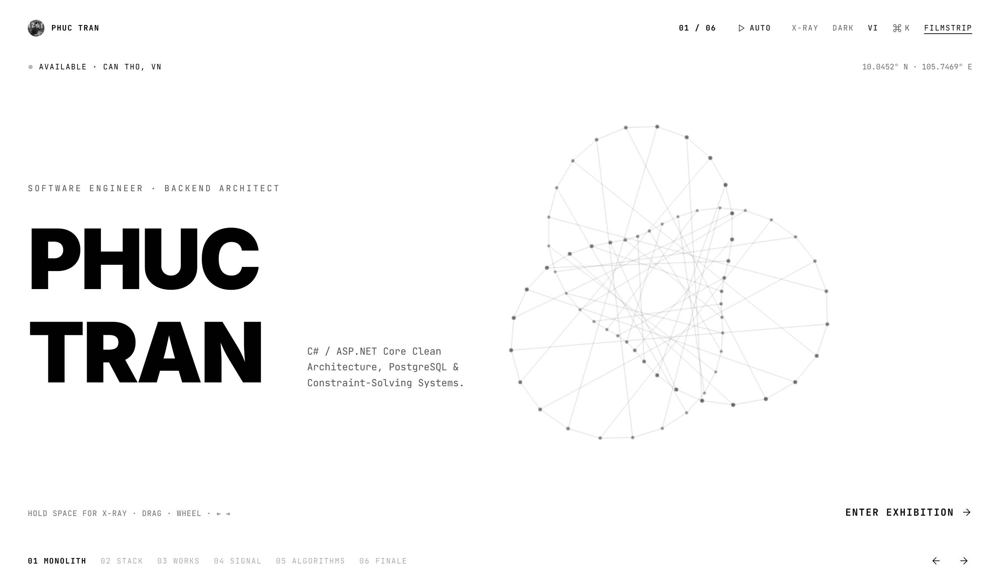

# PHUC TRAN — Personal Portfolio

**Software Engineer · Backend Architect · Can Tho University**

 

---

## Tech Stack

---

## Highlights

- **6-Act Full-Viewport Exhibition:** `Monolith` → `Tech Stack` → `Works` → `Signal` → `Algorithms` → `Finale` (supports drag, scroll wheel, `←`/`→`, `G` Filmstrip, and `⌘K` Command Palette).
- **Interactive Visuals:** 3D Torus-Knot Lattice, Hold-`Space` X-Ray Loupe, Circular Iris-Wipe Case Studies, Clean Architecture Particle Flow, and 4 Live Algorithm Labs (`CTU-Scheduler`, `NewsHub`, `SmartHire`, `Nimdora`).
- **Auto-Play Showcase (`AUTO`):** Plays the background soundtrack and choreographs all 6 Acts automatically.
- **Bilingual (`VI` / `EN`) & Theme Invert:** Type-safe Vietnamese / English switching with Light / Dark Invert toggle.

---

## Contact

- **Email:** [trantrongphuc1501@gmail.com](mailto:trantrongphuc1501@gmail.com)
- **GitHub:** [github.com/phuctran1501](https://github.com/phuctran1501)
